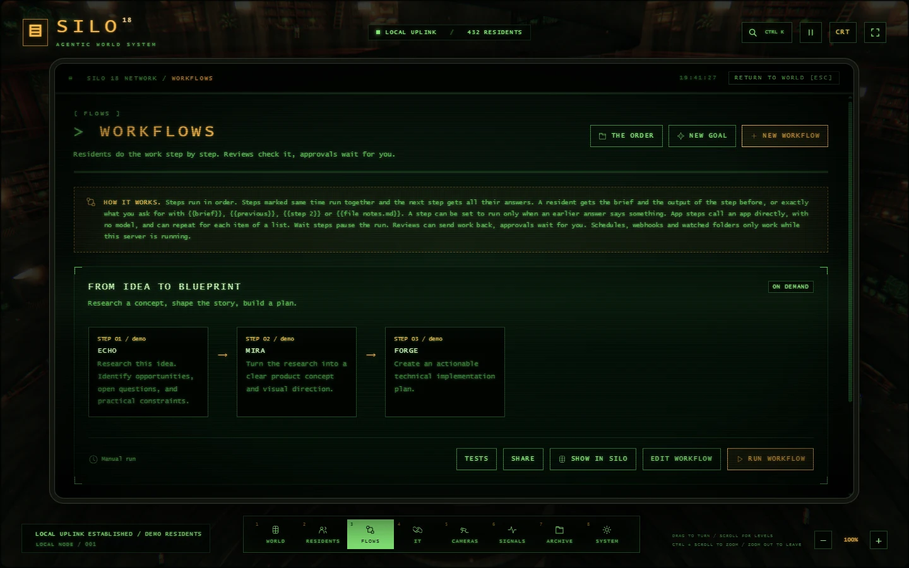
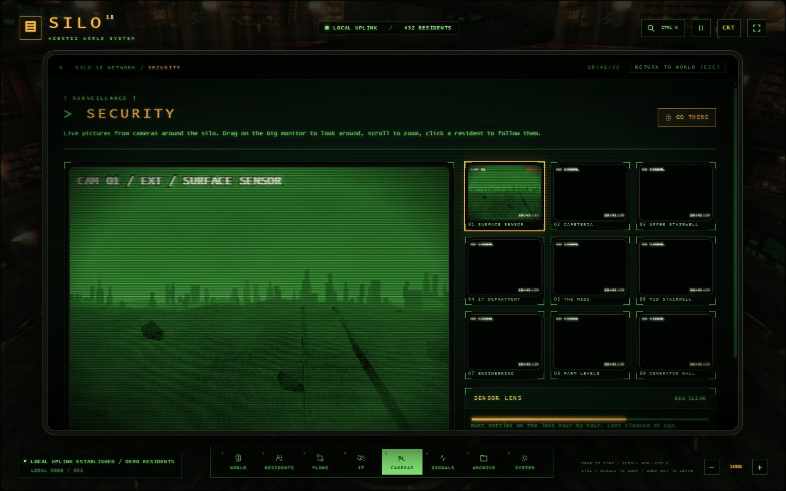
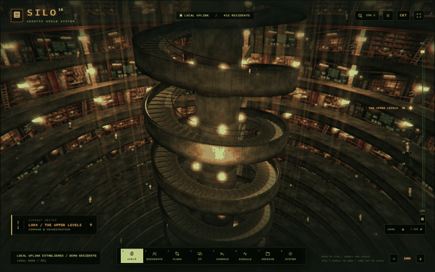

<p align="center">
  
</p>

<h1 align="center">SILO</h1>

<p align="center"><strong>An operations room for AI agents.</strong></p>
<p align="center">Build workflows, connect your tools, and follow each handoff inside a 144-level 3D world.</p>

<p align="center">
  <a href="#what-silo-does">Capabilities</a> &middot;
  <a href="#integrations">Integrations</a> &middot;
  <a href="#quick-start">Quick start</a> &middot;
  <a href="docs/handbook.md">Handbook</a>
</p>


SILO is a self-hosted workspace for AI agents. Assign residents their own models, instructions and permissions. Let them research, draft, review and hand off work. See which step ran, what it used and where it is waiting for you.

The interactive product page lives in [`docs/product/index.html`](docs/product/index.html). Open that file from a checkout to browse the full integration directory and switch between product views.

## What SILO does

| Capability | What you can do |
| :--- | :--- |
| **Residents** | Configure agents with a role, instructions, model, home level and tool permissions. Try demo residents without an API key. |
| **Workflows** | Combine residents, reviews, app actions, waits and approvals. Run steps in parallel, branch on prior results or repeat for every item in a list. |
| **Triggers** | Run on a schedule, a file change, an incoming email, a feed update, an app event or a webhook. |
| **Approvals and traces** | Pause a workflow for a human decision. Inspect model calls, tool use, timings, tokens and estimated costs. Replay from a selected step. |
| **Evaluation and versions** | Test residents and workflows against reference cases, compare changes and restore earlier workflow versions. |
| **Spatial interface** | Navigate 144 levels, locate a resident or follow workflow activity from the live camera room. |

**Example workflow.** A new GitHub issue starts a run. A resident reads the issue and drafts a response. The workflow pauses for your approval and posts the approved comment through the GitHub connector.

| Workflow terminal | Camera room |
| :--- | :--- |
|  |  |

<details>
<summary>Watch the 3D navigation GIF</summary>



</details>

## Integrations

SILO includes **88 app connectors**, **350 app connector operations**, **37 webhook adapters**, and **5 connected account providers**. The [product page source](docs/product/index.html) includes a searchable directory with operations and setup notes.

| Integration | Examples and supported actions |
| :--- | :--- |
| **Google** | Search Gmail, read Drive files, read or append Sheets rows, and create Calendar events. |
| **Microsoft 365** | Search Outlook, read OneDrive files and manage supported Calendar actions. |
| **Slack** | Read channels and post messages with a configured account. |
| **GitHub** | Read files, issues and pull requests. Create, comment on or close issues. |
| **Notion** | Search and read pages, append text, and create pages in a connected database. |
| **App connectors** | Configure supported operations for Stripe, Shopify, Linear, Jira, Airtable, Sentry, Cloudflare and other services. |
| **Incoming events** | Trigger workflows from configured webhooks for services such as GitHub, Slack, Stripe, Shopify, Sentry and Typeform. |
| **Phone and notifications** | Pair a Telegram bot to talk to residents, start workflows or respond to approvals. Send notifications to Slack, Discord, email or a webhook. |
| **Model providers** | Choose OpenAI, Anthropic, local Ollama or an OpenAI-compatible endpoint per resident. |
| **Custom tools** | Add local or remote MCP servers, import OpenAPI 3 or Swagger 2 descriptions, or create a Python tool. |

Each integration requires the appropriate credentials, permissions and service setup. When you connect an external model or service, relevant inputs are sent to it.

## Quick start

1. Install **Node.js 22 or newer** and open a terminal in the repository root.
2. Run:

   ```sh
   npm start
   ```

3. Open [127.0.0.1:3000](http://127.0.0.1:3000). Select **Residents** to try a demo conversation, **Flows** to explore the included workflows, or **IT / Uplink** to connect a provider.

On Windows, use `Start-Silo.cmd` to launch or `Install-SILO.cmd` for a per-user installation. Three.js is bundled. Browsers without WebGL 2 can use the 2D view.

## Developer resources

- [Handbook and operational setup](docs/handbook.md)
- [HTTP API](docs/handbook.md#api-for-programs) and [Python SDK](sdk/python/README.md)
- [MCP and A2A interfaces](docs/handbook.md#silo-for-outside-programs)
- [Data storage](docs/handbook.md#data-and-limits), [account roles and network access](docs/handbook.md#people-and-network-access), and [OpenTelemetry](docs/handbook.md#opentelemetry)

```sh
npm ci
npm run check
npm test
```

## License

SILO's own code is licensed under the [GNU Affero General Public License v3.0](LICENSE) (`AGPL-3.0-only`). Bundled Three.js retains its [MIT license](public/vendor/THREE-LICENSE.txt).
