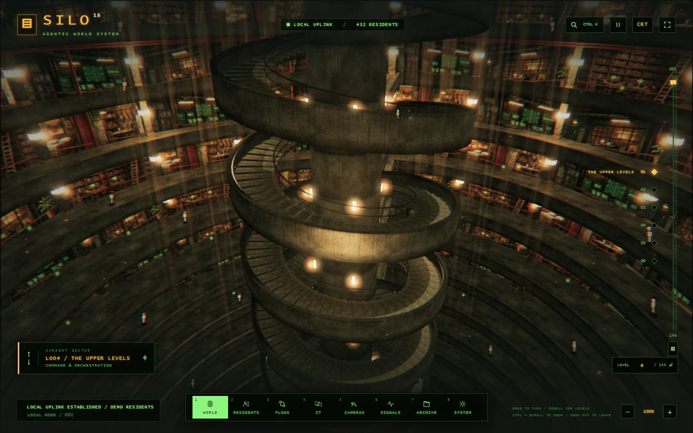

<p align="center">
  
</p>

<h1 align="center">SILO</h1>

<p align="center"><strong>A world for your AI agents.</strong></p>
<p align="center">
  Build workflows, give agents a place to work, and watch each handoff unfold inside a 144-level underground silo.
</p>

<p align="center">
  <a href="#quick-start">Quick start</a> &middot;
  <a href="#inside-the-silo">Inside the silo</a> &middot;
  <a href="docs/handbook.md">Handbook</a> &middot;
  <a href="#license">License</a>
</p>



## Inside the silo

SILO runs on your computer. Agents are residents with a role, instructions, tools, and a home level. Scroll down the shaft to meet them, open a terminal to give them work, or follow them through the camera feeds as a workflow moves from one resident to the next.

<details>
<summary>Watch a short tour of the silo</summary>


</details>

| Workflows | Camera room |
| :--- | :--- |
|  |  |
| Combine residents, app actions, reviews, wait steps, and approvals. Inspect runs and replay from a chosen step. | Switch between live views of the 3D world, follow a resident, or let the active workflow choose the feed. |

- **Choose the model per resident.** Connect OpenAI, Anthropic, local Ollama, or an OpenAI-compatible endpoint. Built-in demo residents let you explore without API keys.
- **Connect the tools you already use.** Configure app integrations or MCP tools, and start workflows from a schedule, webhook, or watched folder.
- **Inspect the work.** Review run traces, compare workflow versions, test outputs against reference cases, and add an approval step where you want to make the decision yourself.
- **Build around it.** Use the HTTP API, [Python SDK](sdk/python/README.md), or the MCP and A2A interfaces described in the [handbook](docs/handbook.md#silo-for-outside-programs).

## Quick start

1. Install **Node.js 22 or newer** and open a terminal in the repository root.
2. Start SILO.

   ```sh
   npm start
   ```

3. Open [127.0.0.1:3000](http://127.0.0.1:3000). Select **Residents** to try a demo conversation or **Flows** to see the included workflows. Use **IT / Uplink** when you are ready to connect a model.

On Windows, double-click `Start-Silo.cmd` to launch from the repository, or run `Install-SILO.cmd` for a per-user installation with Start menu shortcuts. The repository includes Three.js for the 3D interface. A 2D view is available on browsers without WebGL 2.

## Documentation

- [Navigate the world and use the terminals](docs/handbook.md#moving-around)
- [Connect a model provider](docs/handbook.md#connecting-a-model)
- [Use the API and Python SDK](docs/handbook.md#api-for-programs)
- [Install on Windows and configure updates](docs/handbook.md#install-start-at-sign-in-and-updates)
- [Understand data storage and network access](docs/handbook.md#data-and-limits)

## Development

```sh
npm ci
npm run check
npm test
```

Runtime data and workspace files live outside Git history. The screenshots and GIF were captured in a fresh demo instance.

## License

SILO's own code is licensed under the [GNU Affero General Public License v3.0](LICENSE) (`AGPL-3.0-only`). Bundled Three.js retains its [MIT license](public/vendor/THREE-LICENSE.txt).
